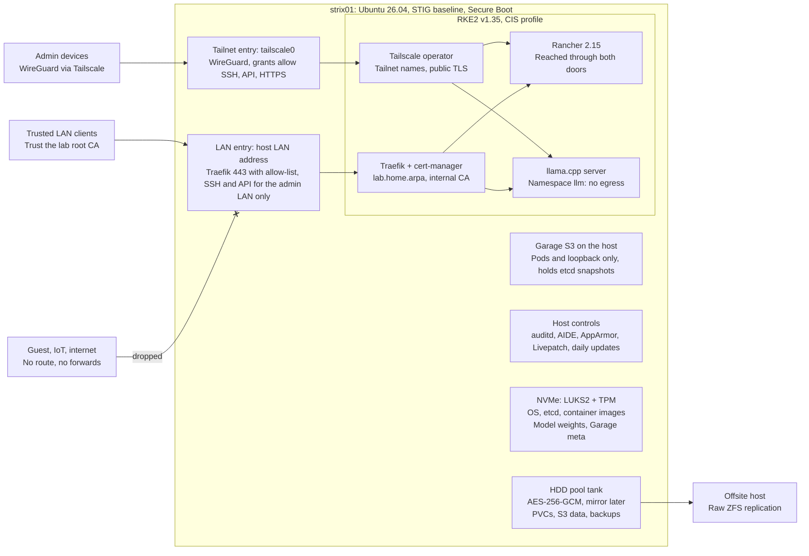

# Strix Halo Runbook: Tailnet + LAN Access

Oct 18, 2026 · @Eric

## Scope and decisions

This version admits two groups: tailnet devices from anywhere, and clients on trusted home subnets. Nothing is reachable from the internet or from untrusted VLANs. Everything not listed below matches the [tailnet-only runbook](https://claude.ai/code/artifact/eb8e9d78-cd6b-4162-b52e-7fd051b4c75c). If every LAN client can run Tailscale, that version is the smaller attack surface.



Tailnet devices come in through `tailscale0` and the Tailscale operator; trusted LAN clients come in through Traefik with an internal-CA certificate. Everything below the entries is unchanged from the tailnet-only build.

| Area | Tailnet-only version | This version |
| --- | --- | --- |
| Admin plane (SSH, Kubernetes API) | `tailscale0` only | `tailscale0`, plus an admin subnet (`$ADMIN_LAN`) as break-glass when Tailscale is unavailable |
| Web services (Rancher, LLM API) | Tailscale operator only | Tailscale operator for the tailnet; RKE2's Traefik for trusted subnets (`$LAN_CIDR`) |
| Ingress controller | Disabled | RKE2's bundled Traefik; ingress-nginx is retired upstream |
| TLS on the LAN | None needed | Two-tier internal CA: an offline root name-constrained to `lab.home.arpa`, with an issuing CA in cert-manager |
| LAN names | None | `rancher.lab.home.arpa` and `llm.lab.home.arpa` in local DNS (`home.arpa` is reserved for home networks) |
| LAN enforcement | Everything dropped | Traefik allow-list returns 403 outside `$LAN_CIDR`; UFW for host ports; the router keeps other VLANs out |
| Internet | No exposure | No exposure: no port forwards, UPnP off |

Unchanged: Ubuntu 26.04, the STIG baseline, ZFS layout, GPU memory budget, the RKE2 CIS profile, Garage, OpenEBS, LLM isolation, patching, and the JMB58x controller gate (Phase 4.0 and 4.2).

Assumptions: 128 GB RAM (64 GB values given where they differ), OS on an internal NVMe, five HDDs on internal SATA, and a router that can separate a trusted client subnet from guest and IoT devices.

## Phase 0: Prerequisites, firmware and network

Set the firmware, prepare the home network, and collect the values below before installing; later phases reuse them.

**Firmware settings**

- Update to the vendor's latest BIOS. AMD attributes 64-bit DMA corruption on Strix Halo to a root-port setting some BIOSes turn on (Phase 4.0).
- UEFI only, Secure Boot on, firmware admin password set.
- TPM 2.0 (fTPM) on, for LUKS unlock in Phase 1.
- iGPU memory (UMA frame buffer) at its minimum, about 512 MB. AMD recommends a small reservation plus a larger shared (TTM/GTT) limit, set in Phase 5.
- SATA in AHCI mode, not RAID.
- IOMMU on (DMA protection). Wi-Fi, Bluetooth and wake-on-LAN off if unused. USB and network boot off after install.

**Network**

- Give the host a fixed address (DHCP reservation or static) on a server subnet or VLAN.
- Decide which client subnets are trusted (`$LAN_CIDR`) and which admin range may reach SSH and the API (`$ADMIN_LAN`, ideally one workstation or a management VLAN).
- Router: no port forwards to the host, UPnP and NAT-PMP off, and guest and IoT VLANs blocked from the server subnet.
- Local DNS (router or Pi-hole): `strix01`, `rancher` and `llm` under `lab.home.arpa`, each pointing at `$LAN_IP`.

**Accounts**

- Tailscale admin access, plus a second admin device already on the tailnet.
- An Ubuntu Pro free personal token (Livepatch and ESM; covers up to 5 machines).
- A Tailscale OAuth client for the Kubernetes operator (Phase 7).

**Variables** (set in your shell for every session; examples shown)

```bash
export HOST=strix01
export ADMIN=eric
export TAILNET=example-tailnet.ts.net          # your MagicDNS suffix
export DISK1=/dev/disk/by-id/ata-EXAMPLE_HDD_SERIAL1
export POD_CIDR=10.42.0.0/16 SVC_CIDR=10.43.0.0/16   # RKE2 defaults
export LAN_IF=enp1s0                          # from: ip -br link
export LAN_IP=192.168.10.20
export LAN_CIDR=192.168.10.0/24               # trusted client subnet
export ADMIN_LAN=192.168.10.5/32              # admin workstation or management VLAN
export LAB_DOMAIN=lab.home.arpa
```

Check: firmware reports Secure Boot enabled and TPM present; `ls -l /dev/disk/by-id/ | grep -v part` lists the first HDD; from a trusted client, `nslookup llm.lab.home.arpa` returns `$LAN_IP`. `lspci -nn | grep -iE '197b:058[25]'` prints a line only if a JMB585 or JMB582 is present; if it does, Phase 4.0 applies.

## Phase 1: Install Ubuntu 26.04 with encrypted, STIG-style mounts

Install Ubuntu Server 26.04.1 on the NVMe with LUKS2 under LVM, one logical volume per STIG-separated path, and leave the HDDs untouched until Phase 4.

1. Download the Server ISO plus `SHA256SUMS` and `SHA256SUMS.gpg`; verify the signature, then the hash.
2. In the installer pick the minimized server, OpenSSH server on, no featured snaps.
3. Choose a custom storage layout on the NVMe (sizes assume 2 TB; scale to yours):

| Mount | Size | Mount options | Reason |
| --- | --- | --- | --- |
| `/boot/efi` | 1 GB | defaults | Unencrypted ESP |
| `/boot` | 2 GB | `nodev,nosuid` | Unencrypted kernels and initramfs |
| LUKS2 volume, LVM group `vg0` | rest of disk |  | Everything below lives inside it |
| `/` | 60 GB | defaults |  |
| `/home` | 10 GB | `nodev,nosuid` | STIG separate mount |
| `/tmp` | 10 GB | `nodev,nosuid,noexec` | STIG separate mount |
| `/var` | 40 GB | `nodev` | STIG separate mount |
| `/var/tmp` | 10 GB | `nodev,nosuid,noexec` | STIG separate mount |
| `/var/log` | 20 GB | `nodev,nosuid,noexec` | STIG separate mount |
| `/var/log/audit` | 20 GB | `nodev,nosuid,noexec` | Audit records can't fill `/var/log` |
| `/var/lib/rancher` | 200 GB | `nodev` | Container images and etcd; must stay executable |
| `/srv/models` | 600 GB, XFS | `nodev,nosuid,noexec` | LLM weights on NVMe, not HDD |
| `/srv/fast` | 50 GB | `nodev,nosuid,noexec` | Garage metadata (random I/O) |
| unallocated | remainder |  | Grow volumes later with `lvextend` |

No swap: the kubelet expects it off.

4. After first boot, bind LUKS to the TPM so patch reboots don't wait at a console. Ubuntu 26.04 builds its initramfs with dracut, so rebuild with dracut after editing crypttab ([26.04 changes](https://computingforgeeks.com/?p=166549)).

```bash
LUKS_DEV=/dev/nvme0n1p3                       # the LUKS partition from lsblk
sudo systemd-cryptenroll --tpm2-device=auto --tpm2-pcrs=7 "$LUKS_DEV"
# In /etc/crypttab, add tpm2-device=auto to that volume's options, then:
sudo dracut -f --regenerate-all
```

Keep the passphrase slot as break-glass and store the recovery passphrase offline. A Secure Boot database update changes PCR 7, so expect one passphrase prompt at the console after such updates; re-run the enrolment afterward.

5. Patch and attach Ubuntu Pro (Livepatch covers 26.04; it ships as a snap, so keep `snapd`):

```bash
sudo apt update && sudo apt full-upgrade -y
sudo pro attach <your-token>
sudo pro enable livepatch
sudo pro status
```

Check: `uname -r` reports a 7.0 kernel, `mokutil --sb-state` says SecureBoot enabled, `findmnt -no OPTIONS /tmp` includes `noexec`, and `sudo systemd-cryptenroll "$LUKS_DEV"` lists both `password` and `tpm2`.

## Phase 2: Harden the OS to the STIG baseline

Apply the [DISA Canonical Ubuntu 24.04 LTS STIG](https://ncp.nist.gov/checklist/revision/6362) (V1R4 is the newest release found) by hand. DISA has no 26.04 STIG, and Canonical's USG automation covers only 22.04 and 24.04 ([Pro feature matrix](https://ubuntu.com/aws/pro?format=md)). Treat the STIG checklist as the source of truth, mark each rule Pass, N/A or Exception, and record exceptions in the register near the end of this doc.

### 2.1 Baseline before changes

```bash
sudo apt install -y lynis openscap-scanner
sudo lynis audit system --quick | tee ~/lynis-before.txt
```

Load the STIG zip from public.cyber.mil into DISA STIG Viewer on your workstation and create a checklist for this host.

### 2.2 Reduce the attack surface

```bash
sudo apt purge -y telnet ftp tftp rsh-client nis avahi-daemon 'cups*' 2>/dev/null
# Crash dumps are on by default in 26.04; dumps can hold keys, and the reservation costs RAM
sudo apt purge -y kdump-tools linux-crashdump && sudo update-grub
```

Purging `avahi-daemon` also stops the host announcing itself over mDNS on the LAN.

`/etc/modprobe.d/60-stig.conf` (internal SATA drives are unaffected by the usb-storage block):

```
install usb-storage /bin/false
blacklist usb-storage
install dccp /bin/false
install rds /bin/false
install tipc /bin/false
install cramfs /bin/false
install freevxfs /bin/false
install hfs /bin/false
install hfsplus /bin/false
install jffs2 /bin/false
install udf /bin/false
```

### 2.3 Accounts, passwords, sudo

```bash
sudo passwd -l root
sudo groupadd sshadmins && sudo usermod -aG sshadmins "$ADMIN"
```

- `/etc/security/pwquality.conf`: `minlen = 15`, `ucredit = -1`, `lcredit = -1`, `dcredit = -1`, `ocredit = -1`, `difok = 8`, `dictcheck = 1`, `enforcing = 1`.
- `/etc/login.defs`: `PASS_MIN_DAYS 1`, `PASS_MAX_DAYS 60`, `ENCRYPT_METHOD SHA512`, `UMASK 077`, then `sudo chage -m 1 -M 60 "$ADMIN"`.
- `/etc/security/faillock.conf`: `deny = 3`, `fail_interval = 900`, `unlock_time = 0`. Add the `pam_faillock` lines to `/etc/pam.d/common-auth` and `common-account` exactly as the STIG fix text gives them, and remove `nullok` from `common-auth`. Test `sudo -v` in a second session before closing the first.
- `/etc/profile.d/99-tmout.sh`: `readonly TMOUT=600; export TMOUT`.
- `/etc/security/limits.d/60-stig.conf`: `* hard maxlogins 10`.
- Banner text in `/etc/issue` and `/etc/issue.net`.
- sudo: 26.04 ships `sudo-rs` as the default `sudo`, which supports a subset of sudoers options ([26.04 changes](https://computingforgeeks.com/?p=165185)). Check each sudo-related STIG rule against it (no `NOPASSWD`, no `!authenticate`). If a required directive isn't supported, switch to classic sudo, which stays installed: `sudo update-alternatives --config sudo`.

### 2.4 SSH

`/etc/ssh/sshd_config.d/10-stig.conf`, then `sudo sshd -t && sudo systemctl reload ssh`:

```
PermitRootLogin no
PasswordAuthentication no
KbdInteractiveAuthentication no
PermitEmptyPasswords no
PubkeyAuthentication yes
UsePAM yes
AllowGroups sshadmins
X11Forwarding no
AllowTcpForwarding no
MaxAuthTries 3
MaxStartups 10:30:60
ClientAliveInterval 600
ClientAliveCountMax 1
LogLevel VERBOSE
Banner /etc/issue.net
Ciphers aes256-gcm@openssh.com,aes128-gcm@openssh.com,aes256-ctr,aes192-ctr,aes128-ctr
MACs hmac-sha2-512-etm@openssh.com,hmac-sha2-256-etm@openssh.com,hmac-sha2-512,hmac-sha2-256
KexAlgorithms mlkem768x25519-sha256,ecdh-sha2-nistp384,ecdh-sha2-nistp256,diffie-hellman-group-exchange-sha256
```

The first KEX entry is OpenSSH 10.2's post-quantum hybrid; keeping it is a logged deviation (E-05). `MaxStartups` throttles unauthenticated connections, which matters now that SSH also listens for the admin subnet. Port exposure is limited to the tailnet and `$ADMIN_LAN` in Phase 3.

### 2.5 Kernel parameters and boot

`/etc/sysctl.d/60-stig.conf`, then `sudo sysctl --system`:

```
kernel.randomize_va_space = 2
kernel.dmesg_restrict = 1
kernel.kptr_restrict = 2
kernel.yama.ptrace_scope = 1
kernel.unprivileged_bpf_disabled = 1
net.core.bpf_jit_harden = 2
fs.protected_hardlinks = 1
fs.protected_symlinks = 1
fs.suid_dumpable = 0
net.ipv4.conf.all.accept_redirects = 0
net.ipv4.conf.default.accept_redirects = 0
net.ipv4.conf.all.send_redirects = 0
net.ipv4.conf.default.send_redirects = 0
net.ipv4.conf.all.accept_source_route = 0
net.ipv4.tcp_syncookies = 1
net.ipv4.icmp_echo_ignore_broadcasts = 1
net.ipv6.conf.all.accept_redirects = 0
net.ipv6.conf.default.accept_redirects = 0
```

Do not set `net.ipv4.ip_forward = 0`; Kubernetes needs forwarding (E-03).

- Kernel command line: create `/etc/default/grub.d/90-stig.cfg` with `GRUB_CMDLINE_LINUX="$GRUB_CMDLINE_LINUX audit=1 audit_backlog_limit=8192"`, then `sudo update-grub`. Keep the IOMMU in translated mode (the Ubuntu default): never add `amd_iommu=off`, `iommu=off` or `iommu=pt`, which weaken DMA protection. A JMB58x box adds `amd_iommu=pgtbl_v2` in Phase 4.0.
- GRUB superuser: hash a password with `grub-mkpasswd-pbkdf2`, add `set superusers="root"` and the `password_pbkdf2` line to `/etc/grub.d/40_custom`, and add `--unrestricted` to the default entries so unattended boots still work. Re-check after GRUB package updates.

### 2.6 AppArmor, audit, file integrity, time

```bash
sudo apt install -y apparmor-utils auditd audispd-plugins aide aide-common
sudo aa-status            # every loaded profile in enforce mode
```

`/etc/audit/auditd.conf`: `space_left = 25%`, `space_left_action = email`, `action_mail_acct = root`, `admin_space_left_action = single`, `max_log_file_action = keep_logs`, `disk_full_action = SYSLOG` (E-09). Rules in `/etc/audit/rules.d/50-stig.rules`; the STIG lists every required rule, and this is the core set plus the cluster paths:

```
-w /etc/passwd -p wa -k identity
-w /etc/group -p wa -k identity
-w /etc/shadow -p wa -k identity
-w /etc/gshadow -p wa -k identity
-w /etc/security/opasswd -p wa -k identity
-w /etc/sudoers -p wa -k privileged
-w /etc/sudoers.d/ -p wa -k privileged
-w /var/run/faillock -p wa -k logins
-w /var/log/wtmp -p wa -k logins
-w /var/log/btmp -p wa -k logins
-a always,exit -F arch=b64 -S execve -C uid!=euid -F euid=0 -k execpriv
-a always,exit -F arch=b64 -S chmod,fchmod,fchmodat -F auid>=1000 -F auid!=unset -k perm_mod
-a always,exit -F arch=b64 -S chown,fchown,fchownat,lchown -F auid>=1000 -F auid!=unset -k perm_mod
-a always,exit -F arch=b64 -S setxattr,lsetxattr,fsetxattr,removexattr,lremovexattr,fremovexattr -F auid>=1000 -F auid!=unset -k perm_mod
-a always,exit -F arch=b64 -S unlink,unlinkat,rename,renameat -F auid>=1000 -F auid!=unset -k delete
-a always,exit -F arch=b64 -S init_module,finit_module,delete_module -F auid>=1000 -F auid!=unset -k module_chng
-w /etc/ssh/sshd_config.d/ -p wa -k sshd
-w /etc/rancher/ -p wa -k rke2-config
-w /var/lib/rancher/rke2/server/cred/ -p wa -k rke2-creds
-w /etc/zfs/keys/ -p rwa -k zfs-keys
-e 2
```

For the privileged-command rules, point `-F path=` at the real binaries (`readlink -f /usr/bin/sudo` resolves the sudo-rs path). `-e 2` locks the rules until reboot. Load with `sudo augenrules --load`.

AIDE: create `/etc/aide/aide.conf.d/90-local-exclusions` with `!/var/lib/rancher`, `!/var/lib/kubelet`, `!/var/log/pods`, `!/var/log/containers`, `!/srv/models`, `!/srv/fast` and `!/tank` (E-07), then `sudo aideinit -y -f`.

Time: 26.04 installs chrony with NTS-authenticated Ubuntu time servers by default ([release summary](https://versionlog.com/ubuntu/26.04/)). Confirm with `chronyc -N authdata`.

Check: `sudo auditctl -s` shows `enabled 2`, `sudo sshd -T | grep -i ciphers` matches the list above, `aa-status` shows nothing in complain mode, and a new `lynis audit system` scores higher than `~/lynis-before.txt`. Update the STIG Viewer checklist.

## Phase 3: Access paths: tailnet plus trusted LAN

Two private paths reach the host: the tailnet from anywhere, and the trusted LAN at home. Admin ports open only to the tailnet and `$ADMIN_LAN`. Web services reach the tailnet through the Tailscale operator and `$LAN_CIDR` through Traefik.

| Port | Service | Tailnet | `$ADMIN_LAN` | Rest of `$LAN_CIDR` | Anywhere else |
| --- | --- | --- | --- | --- | --- |
| 22/tcp | SSH | Yes | Yes | No | No |
| 6443/tcp | Kubernetes API | Yes | Yes | No | No |
| 443/tcp on `$LAN_IP` | Traefik: Rancher, LLM API | Uses operator names instead | Yes | Yes | 403 from Traefik; the router should block it first |
| 80/tcp on `$LAN_IP` | Redirect to 443 | No | Yes | Yes | Redirect only, then 403 |
| 3900/tcp | Garage S3 | No | No | No | Pods and loopback only |

**Tailnet policy** (admin console → Access controls). Tailscale manages its own netfilter rules for `tailscale0`, so these grants are the port filter that binds for tailnet traffic:

```json
{
  "tagOwners": {
    "tag:strix":        ["autogroup:admin"],
    "tag:k8s-operator": ["autogroup:admin"],
    "tag:k8s":          ["tag:k8s-operator"]
  },
  "grants": [
    {"src": ["autogroup:admin"], "dst": ["tag:strix"], "ip": ["tcp:22", "tcp:6443"]},
    {"src": ["autogroup:admin"], "dst": ["tag:k8s"],   "ip": ["tcp:443"]}
  ]
}
```

Do not advertise the LAN as a subnet route from this host; tailnet clients use the operator names, so the tailnet never gains a path into the rest of the home network.

**Install Tailscale from its signed repository** (use the `noble` files if `resolute` isn't listed yet):

```bash
curl -fsSL https://pkgs.tailscale.com/stable/ubuntu/resolute.noarmor.gpg \
  | sudo tee /usr/share/keyrings/tailscale-archive-keyring.gpg >/dev/null
curl -fsSL https://pkgs.tailscale.com/stable/ubuntu/resolute.tailscale-keyring.list \
  | sudo tee /etc/apt/sources.list.d/tailscale.list
sudo apt update && sudo apt install -y tailscale
sudo tailscale up --advertise-tags=tag:strix --ssh=false
export TS_IP=$(tailscale ip -4)
```

**Host firewall**

```bash
sudo ufw default deny incoming
sudo ufw default allow outgoing
# Tailnet
sudo ufw allow in on tailscale0 to any port 22 proto tcp
sudo ufw allow in on tailscale0 to any port 6443 proto tcp
# Admin subnet, LAN interface only
sudo ufw allow in on "$LAN_IF" from "$ADMIN_LAN" to "$LAN_IP" port 22 proto tcp
sudo ufw allow in on "$LAN_IF" from "$ADMIN_LAN" to "$LAN_IP" port 6443 proto tcp
# Trusted clients to the ingress (records intent; see below)
sudo ufw allow in on "$LAN_IF" from "$LAN_CIDR" to "$LAN_IP" port 80,443 proto tcp
# Cluster-internal
sudo ufw allow from "$POD_CIDR"
sudo ufw allow from "$SVC_CIDR"
sudo ufw allow 41641/udp           # Tailscale direct connections (optional)
sudo ufw logging medium
sudo ufw enable
```

UFW filters traffic addressed to the host itself. Traffic to Traefik's ports is handed to a pod by the CNI before UFW sees it, so the control that binds there is Traefik's entrypoint allow-list in Phase 7, set to the same `$LAN_CIDR`. The UFW rule still applies if Traefik ever moves to host networking. NodePorts stay pinned to loopback (Phase 6). The router's VLAN rules are the outer layer, and SSH from `$ADMIN_LAN` is the break-glass path when Tailscale is down.

Check: from `$ADMIN_LAN`, SSH and `nc -zv $LAN_IP 6443` succeed. From another trusted client, ports 22 and 6443 are filtered but 443 answers. From a guest or IoT device, nothing answers. From a tailnet admin device, `ssh $ADMIN@$HOST` works.

## Phase 4: ZFS pool on the HDDs

Create pool `tank` on the first HDD, encrypt everything under `tank/enc`, and grow it by attaching a mirror partner and then adding mirror pairs. Ubuntu 26.04 ships ZFS 2.4.1 prebuilt for its kernel ([package](https://packages.ubuntu.com/eu/resolute/arm64/zfsutils-linux)), so there is no DKMS step.

### 4.0 JMicron JMB58x gate (only if the controller is present)

Skip to 4.1 if the Phase 0 `lspci` check printed nothing. The JMB585 and JMB582 advertise 64-bit DMA but silently corrupt data at addresses above 4 GB, and only checksumming filesystems such as ZFS notice ([root-cause analysis](https://github.com/artmoty-dev/n5pro-jmb585-fix)). Linux 7.0 forces both chips to 32-bit DMA ([commit 105c4256](https://code.googlesource.com/linux/torvalds/linux/+/105c42566a550e2d05fc14f763216a8765ee5d0e), merged for [7.0-final](https://ratatoskr.run/linux-ide/2026/04/16730767/t)), so on 26.04 you verify the fix instead of building a kernel.

1. Confirm the quirk is active on the controller:

```bash
lspci -nn | grep -iE '197b:058[25]'      # 0585 = JMB585, 0582 = JMB582
sudo dmesg | grep -i 'forcing 32bit'
# expect: ahci 0000:XX:00.0: controller can't do 64bit DMA, forcing 32bit
lsblk -o NAME,MODEL,SERIAL,TRAN          # every drive on the controller is listed
```

2. Check the follow-up fix. On some boards the quirk left two port registers set and the controller stopped working at probe. That is CVE-2026-98262, fixed upstream in 7.3-rc4 and the stable kernels ([OSV](https://osv.dev/vulnerability/CVE-2026-98262)). Run `pro fix CVE-2026-98262`; if a drive is missing from `lsblk`, stop until Ubuntu ships a fixed kernel.
3. Add `amd_iommu=pgtbl_v2` as defense in depth. It switches the AMD IOMMU to fixed-depth v2 page tables, which keep DMA addresses under 48 bits. AMD attributes the corruption to a root-port "enhanced atomics" setting on Strix Halo-class chips that breaks DMA above 58 bits, for NVMe as well as SATA; its fix is queued for 7.3 with a stable tag ([AMD v2 series](https://ratatoskr.run/lkml/2026/09/17533339/t)).

```bash
echo 'GRUB_CMDLINE_LINUX="$GRUB_CMDLINE_LINUX amd_iommu=pgtbl_v2"' | sudo tee /etc/default/grub.d/91-jmb58x.cfg
sudo update-grub && sudo reboot
# after the reboot
grep -o 'amd_iommu=pgtbl_v2' /proc/cmdline
sudo dmesg | grep -E 'iommu: Default domain type|IO_PAGE_FAULT'   # "Translated", and no faults
```

The LUKS TPM binding uses PCR 7 only, so the command-line change needs no re-enrolment. The repo also sets `pcie_aspm=off`; add it only if the log shows PCIe AER errors or the controller dropping off the bus, since it raises idle power.

4. Do not follow the repo's Fedora kernel build. A self-built kernel isn't signed by Canonical, so it breaks Secure Boot, the prebuilt ZFS modules and Livepatch. Do not use `amd_iommu=off` or `iommu=pt` as the fix either: they hide the fault by giving up DMA translation. Record the controller under E-15, build the pool in 4.1, then run the 4.2 burn-in before real data lands.

### 4.1 Pool and datasets

```bash
sudo apt install -y zfsutils-linux sanoid smartmontools
sudo zpool create -o ashift=12 \
  -O compression=lz4 -O atime=off -O xattr=sa -O acltype=posixacl \
  -O mountpoint=/tank -O canmount=off tank "$DISK1"

# Raw key on the LUKS-protected root: the pool unlocks only after the OS volume does
sudo install -d -m 0700 /etc/zfs/keys
sudo dd if=/dev/urandom of=/etc/zfs/keys/tank-enc.key bs=32 count=1
sudo chmod 0400 /etc/zfs/keys/tank-enc.key
sudo zfs create -o encryption=aes-256-gcm -o keyformat=raw \
  -o keylocation=file:///etc/zfs/keys/tank-enc.key -o canmount=off tank/enc

sudo zfs create -o mountpoint=none tank/enc/k8s                         # OpenEBS PVC datasets
sudo zfs create -o mountpoint=/tank/s3 -o recordsize=1M tank/enc/s3      # Garage data
sudo zfs create -o mountpoint=/tank/backup -o recordsize=1M tank/enc/backup
sudo zfs set copies=2 tank/enc/backup     # single-disk period only (E-08)
```

Copy the key file to offline storage now; losing it loses the pool. `copies=2` guards against bad sectors, not a dead disk, and applies only to data written after it is set. Never share ZFS datasets over SMB or NFS to the LAN from this host; that would add a file-sharing surface this design does not account for.

Load keys at boot with `/etc/systemd/system/zfs-load-key.service`, then `sudo systemctl enable zfs-load-key`:

```ini
[Unit]
Description=Load ZFS encryption keys
DefaultDependencies=no
After=zfs-import.target
Before=zfs-mount.service

[Service]
Type=oneshot
RemainAfterExit=yes
ExecStart=/usr/sbin/zfs load-key -a

[Install]
WantedBy=zfs-mount.service
```

**Health and snapshots**

- Scrubs: confirm the monthly scrub job from `zfsutils-linux` is present (`systemctl list-timers` or `/etc/cron.d/zfsutils-linux`). On a JMB58x box, scrub weekly instead (E-15): `sudo systemctl enable --now zfs-scrub-weekly@tank.timer` if `systemctl list-unit-files 'zfs-scrub*'` lists it, otherwise a weekly cron line running `zpool scrub tank`.
- ZED alerts: set `ZED_EMAIL_ADDR` and `ZED_NOTIFY_VERBOSE=1` in `/etc/zfs/zed.d/zed.rc`, with a mail relay such as `msmtp`.
- SMART: enable `smartd` with a short self-test daily and a long one weekly.
- Snapshots: `/etc/sanoid/sanoid.conf`

```ini
[tank/enc]
  use_template = production
  recursive = yes

[template_production]
  hourly = 24
  daily = 30
  monthly = 6
  autosnap = yes
  autoprune = yes
```

**Growth path (mirror route)**

| Drives | Command | Result |
| --- | --- | --- |
| 2 | `sudo zpool attach tank "$DISK1" "$DISK2"` | Two-way mirror; then `sudo zfs set copies=1 tank/enc/backup` |
| 4 | `sudo zpool add tank mirror "$DISK3" "$DISK4"` | Two mirror vdevs, 50% of raw capacity usable |
| 5 | `sudo zpool add tank spare "$DISK5"` | Hot spare; 40% of raw capacity usable |

Decision point before drive 2: a mirror can never become RAIDZ. To end at RAIDZ2 instead (60% usable, any two drives can fail), skip the attach. Once you hold drives 2–4, build a new RAIDZ2 pool from those three and copy over with `zfs send -Rw` (raw, so encryption carries over). Destroy `tank`, then widen the new vdev with the old disk: `zpool attach <newpool> raidz2-0 "$DISK1"`. RAIDZ expansion keeps the parity level and can repeat ([OpenZFS](https://github.com/openzfs/zfs/pull/12225)). Blocks written before an expansion keep the old data-to-parity ratio until rewritten with `zfs rewrite` ([2.3.4 notes](https://en.linuxadictos.com/OpenZFS-2--3--and-4-arrive-with-expanded-compatibility-and-ZFS-Rewrite-in-detail..html)).

Check: `zpool status tank` is ONLINE with no errors, and after a reboot `zfs get keystatus tank/enc` says `available`. `sudo smartctl -H "$DISK1"` says PASSED.

### 4.2 JMB58x burn-in (only if the controller is present)

The corruption is silent, so prove the path with sustained writes and a full scrub before real data lands. Four jobs of 50 GB is a starting point; a longer soak is better.

```bash
sudo apt install -y fio
sudo zfs create -o mountpoint=/tank/burnin -o compression=off tank/burnin
sudo fio --name=burnin --directory=/tank/burnin --rw=write --bs=1M --size=50G \
  --numjobs=4 --ioengine=libaio --iodepth=16 --refill_buffers --end_fsync=1
sudo zpool scrub -w tank
zpool status -v tank     # READ, WRITE and CKSUM all 0; "No known data errors"
sudo dmesg | grep -iE 'IO_PAGE_FAULT|ata[0-9.]+: .*(failed|reset|error)'   # expect nothing
sudo zfs destroy tank/burnin
```

Any checksum error fails the gate: keep data off the pool and re-check 4.0. Repeat the burn-in once after Phase 8 with a model loaded and serving, so it covers the box as it will run. With one disk, ZFS detects this corruption but cannot repair it, so on a JMB58x box attach the mirror partner before data you can't re-create lands (E-08).

## Phase 5: GPU and unified-memory budget

Let the iGPU map up to 96 GB of shared memory, cap the ZFS ARC at 12 GB, and leave about 20 GB for the host and cluster. The shared limit is a ceiling, not a reservation: GTT memory returns to the system when the GPU frees it ([AMD RDNA3.5 guide](https://rocm.docs.amd.com/en/docs-7.14.0/_sources/reference/system-optimization/rdna3-5.rst)).

| Consumer | 128 GB box | 64 GB box | Where it is set |
| --- | --- | --- | --- |
| Firmware UMA reservation | 0.5 GB | 0.5 GB | BIOS (Phase 0) |
| GPU shared limit (TTM/GTT) | 96 GB | 40 GB | `ttm pages_limit` |
| ZFS ARC maximum | 12 GB | 6 GB | `zfs_arc_max` |
| Host, RKE2, Rancher, Traefik, Garage | about 19.5 GB | about 17.5 GB | kubelet reservations (Phase 6) |

AMD requires specific KFD fixes for this chip; Ubuntu 26.04's generic kernel is in AMD's supported column, so no kernel change is needed.

```bash
# GPU shared limit: 96 GiB = 25165824 pages of 4 KiB (64 GB box: 10485760)
echo 'options ttm pages_limit=25165824' | sudo tee /etc/modprobe.d/ttm.conf

# ARC cap: 12 GiB (64 GB box: 6442450944)
echo 'options zfs zfs_arc_max=12884901888' | sudo tee /etc/modprobe.d/zfs.conf
echo 12884901888 | sudo tee /sys/module/zfs/parameters/zfs_arc_max

# amdgpu and ttm can load from the initramfs, which 26.04 builds with dracut
sudo dracut -f --regenerate-all
sudo reboot
```

AMD's `amd-ttm` helper (`pipx install amd-debug-tools`) reads and sets the same limit if you prefer it. Keep `linux-firmware` current: one release (20251125) was reported to break ROCm on Strix Halo ([Strix Halo toolboxes](https://github.com/kyuz0/amd-strix-halo-toolboxes)).

Check: `cat /sys/module/ttm/parameters/pages_limit` prints 25165824, `arc_summary | grep -i 'max size'` shows 12 GiB, and `/dev/dri/renderD128` and `/dev/kfd` both exist. On a JMB58x box, `sudo dmesg | grep -iE 'IO_PAGE_FAULT|amdgpu.*(fail|error)'` prints nothing with `amd_iommu=pgtbl_v2` set; if it does, remove that parameter and note it under E-15.

## Phase 6: RKE2 with the CIS profile and Traefik

Install RKE2 from the v1.35 channel with `profile: cis`, Traefik as the only ingress controller, NodePorts pinned to loopback, and a real API audit policy. RKE2 becomes Traefik-by-default at v1.36, and v1.35 can already select it ([RKE2 ingress migration](https://docs.rke2.io/reference/ingress_migration)), so this cluster never runs the retired ingress-nginx. Kubernetes 1.35 is supported by Rancher 2.14 and 2.15 ([2.14.6 notes](https://documentation.suse.com/cloudnative/rancher-manager/v2.14/en/release-notes/v2.14.6.html)). For STIG coverage of this layer, use DISA's Rancher Government Solutions RKE2 STIG.

**Prerequisites from the [RKE2 hardening guide](https://docs.rke2.io/security/hardening_guide)**

```bash
sudo useradd -r -c "etcd user" -s /sbin/nologin -M etcd -U
curl -sfL https://get.rke2.io -o ~/rke2-install.sh     # read it before running
sudo INSTALL_RKE2_CHANNEL=v1.35 sh ~/rke2-install.sh
sudo cp -f /usr/local/share/rke2/rke2-cis-sysctl.conf /etc/sysctl.d/60-rke2-cis.conf
sudo systemctl restart systemd-sysctl
```

On Ubuntu the installer uses the tarball method, hence the `/usr/local/share/rke2` path.

**`/etc/rancher/rke2/config.yaml`** (mode 0600; substitute your values):

```yaml
profile: cis
write-kubeconfig-mode: "0600"
node-name: strix01
tls-san:
  - strix01.example-tailnet.ts.net
  - 100.64.0.10                      # $TS_IP
  - strix01.lab.home.arpa
  - 192.168.10.20                    # $LAN_IP, for kubectl from $ADMIN_LAN
ingress-controller:
  - traefik                          # LAN ingress; tailnet uses the Tailscale operator
secrets-encryption: true             # already the default; explicit for the STIG check
audit-policy-file: /etc/rancher/rke2/audit-policy.yaml
kube-apiserver-arg:
  - audit-log-maxage=30
  - audit-log-maxbackup=10
  - audit-log-maxsize=100
kube-proxy-arg:
  - nodeport-addresses=127.0.0.0/8   # a NodePort can never open on the LAN
kubelet-arg:
  - system-reserved=cpu=1,memory=4Gi
  - kube-reserved=cpu=1,memory=4Gi
  - eviction-hard=memory.available<2Gi,nodefs.available<10%
etcd-snapshot-schedule-cron: "0 */6 * * *"
etcd-snapshot-retention: 28
```

**`/etc/rancher/rke2/audit-policy.yaml`**: metadata for secrets (never bodies), full detail for RBAC changes and exec:

```yaml
apiVersion: audit.k8s.io/v1
kind: Policy
omitStages: ["RequestReceived"]
rules:
  - level: None
    nonResourceURLs: ["/healthz*", "/readyz*", "/livez*", "/version"]
  - level: None
    users: ["system:kube-proxy"]
    verbs: ["watch"]
  - level: Metadata
    resources:
      - group: ""
        resources: ["secrets", "configmaps", "serviceaccounts/token"]
  - level: RequestResponse
    verbs: ["create", "update", "patch", "delete"]
    resources:
      - group: "rbac.authorization.k8s.io"
      - group: ""
        resources: ["pods/exec", "pods/attach", "pods/portforward"]
  - level: Metadata
```

**Start and connect**

```bash
sudo systemctl enable --now rke2-server
mkdir -p ~/.kube && sudo install -m 0600 -o "$ADMIN" /etc/rancher/rke2/rke2.yaml ~/.kube/config
export PATH=$PATH:/var/lib/rancher/rke2/bin
kubectl get nodes
sudo rke2 secrets-encrypt status
kubectl get ingressclass               # note Traefik's class name for Phase 7
```

Install Helm 3.18 or newer (Rancher requires it) from the release tarball, verifying the published SHA-256.

The CIS profile sets cluster-wide Pod Security Admission to `restricted`, with system namespaces exempt. A namespace that needs more (OpenEBS's node plugin, for example) gets an explicit label in Phase 7, never a blanket exemption.

Check: the node is Ready. `rke2 secrets-encrypt status` reports Enabled. `kubectl get pods -n kube-system` shows Traefik and no ingress-nginx. `kubectl run psa-test --image=busybox --privileged -n default` is rejected. `sudo ss -tlnp` shows no NodePort range (30000–32767) bound outside 127.0.0.1.

## Phase 7: Storage, S3, certificates, ingress, Rancher, backups

Garage runs on the host so S3 survives a broken cluster, and OpenEBS turns `tank/enc/k8s` into PVCs. Each web service gets two front doors: the Tailscale operator for the tailnet, and Traefik with an internal-CA certificate and a LAN allow-list for home clients. etcd snapshots, which hold Rancher's state too, land in Garage and then go offsite.

### 7.1 Garage S3 on the host

MinIO's community repository was archived in February 2026 ([background](https://blog.vonng.com/en/db/minio-resurrect/index.md)); Garage is a single binary with a one-node mode (`replication_factor = 1`, [quick start](https://garagehq.deuxfleurs.fr/documentation/quick-start)). Download the current static `x86_64` release, verify its SHA-256, and install it as `/usr/local/bin/garage`. It stays off the LAN: only pods and loopback reach it.

```bash
sudo useradd -r -s /usr/sbin/nologin -d /var/lib/garage garage
sudo install -d -o garage -g garage -m 0700 /srv/fast/garage-meta /tank/s3/data /etc/garage
for f in rpc_secret admin_token metrics_token; do
  openssl rand -hex 32 | sudo tee /etc/garage/$f >/dev/null
done
sudo chown garage:garage /etc/garage/* && sudo chmod 0600 /etc/garage/*
```

`/etc/garage.toml`:

```toml
metadata_dir = "/srv/fast/garage-meta"   # NVMe: metadata is random I/O
data_dir = "/tank/s3/data"
db_engine = "lmdb"
replication_factor = 1
rpc_bind_addr = "127.0.0.1:3901"
rpc_public_addr = "127.0.0.1:3901"
rpc_secret_file = "/etc/garage/rpc_secret"

[s3_api]
s3_region = "garage"
api_bind_addr = "0.0.0.0:3900"          # UFW admits only pods and localhost
root_domain = ".s3.garage.internal"

[admin]
api_bind_addr = "127.0.0.1:3903"
admin_token_file = "/etc/garage/admin_token"
metrics_token_file = "/etc/garage/metrics_token"
```

`/etc/systemd/system/garage.service`:

```ini
[Unit]
Description=Garage S3 object storage
After=network-online.target zfs-mount.service
Wants=network-online.target
RequiresMountsFor=/tank/s3 /srv/fast

[Service]
User=garage
Group=garage
ExecStart=/usr/local/bin/garage -c /etc/garage.toml server
NoNewPrivileges=true
ProtectSystem=strict
ReadWritePaths=/tank/s3/data /srv/fast/garage-meta
ProtectHome=true
PrivateTmp=true
PrivateDevices=true
ProtectKernelTunables=true
ProtectKernelModules=true
ProtectControlGroups=true
RestrictAddressFamilies=AF_INET AF_INET6 AF_UNIX
RestrictNamespaces=true
LockPersonality=true
MemoryDenyWriteExecute=true
CapabilityBoundingSet=
SystemCallFilter=@system-service

[Install]
WantedBy=multi-user.target
```

```bash
sudo systemctl enable --now garage
alias g='sudo -u garage garage -c /etc/garage.toml'
g status                                   # copy the node ID
g layout assign -z dc1 -c 2T <node-id>
g layout apply --version 1
g bucket create etcd-snapshots
g key create rke2-etcd                     # note the key ID and secret
g bucket allow --read --write etcd-snapshots --key rke2-etcd
```

### 7.2 OpenEBS ZFS-LocalPV

```bash
helm repo add openebs https://openebs.github.io/openebs && helm repo update
kubectl create namespace openebs
kubectl label ns openebs pod-security.kubernetes.io/enforce=privileged   # node plugin mounts host paths
helm install openebs openebs/openebs -n openebs \
  --set engines.replicated.mayastor.enabled=false \
  --set engines.local.lvm.enabled=false \
  --set loki.enabled=false --set alloy.enabled=false
```

StorageClass (`poolname` may name a child dataset, [OpenEBS](https://www.github.com/openebs/zfs-localpv)):

```yaml
apiVersion: storage.k8s.io/v1
kind: StorageClass
metadata:
  name: zfs-tank
  annotations:
    storageclass.kubernetes.io/is-default-class: "true"
provisioner: zfs.csi.openebs.io
parameters:
  poolname: "tank/enc/k8s"     # children inherit encryption
  fstype: "zfs"
  compression: "lz4"
  recordsize: "128k"
allowVolumeExpansion: true
reclaimPolicy: Retain
volumeBindingMode: WaitForFirstConsumer
```

If `openebs-hostpath` is also marked default, unmark it so PVCs land on ZFS.

### 7.3 Internal CA for LAN names

Use two tiers: a root that stays offline, and an issuing CA that lives in cert-manager. Both are name-constrained to `lab.home.arpa`, so a leaked issuing key cannot mint a certificate your devices would trust for any other domain. Run this on an admin workstation, not the server:

```bash
umask 077 && mkdir lab-ca && cd lab-ca
# Root CA, 10 years; its key is passphrase-protected (you'll be prompted)
openssl req -x509 -new -newkey ec -pkeyopt ec_paramgen_curve:P-384 -sha384 -days 3650 \
  -keyout root.key -out root.crt -subj "/CN=Home Lab Root CA" \
  -addext "basicConstraints=critical,CA:TRUE,pathlen:1" \
  -addext "keyUsage=critical,keyCertSign,cRLSign" \
  -addext "nameConstraints=critical,permitted;DNS:lab.home.arpa"
# Issuing CA, 2 years, unencrypted key for cert-manager
openssl req -new -newkey ec -pkeyopt ec_paramgen_curve:P-256 -noenc \
  -keyout issuing.key -out issuing.csr -subj "/CN=strix01 Issuing CA"
printf '%s\n' 'basicConstraints=critical,CA:TRUE,pathlen:0' \
  'keyUsage=critical,keyCertSign,cRLSign' \
  'nameConstraints=critical,permitted;DNS:lab.home.arpa' > issuing.ext
openssl x509 -req -in issuing.csr -CA root.crt -CAkey root.key -CAcreateserial \
  -sha384 -days 730 -extfile issuing.ext -out issuing.crt
cat issuing.crt root.crt > issuing-chain.crt
```

Move `root.key` to encrypted offline storage. Install `root.crt` in the trust store of each trusted LAN client. Copy `issuing.key` and `issuing-chain.crt` to the server over the tailnet, then:

```bash
helm repo add jetstack https://charts.jetstack.io && helm repo update
helm install cert-manager jetstack/cert-manager -n cert-manager --create-namespace --set crds.enabled=true
kubectl -n cert-manager create secret tls lab-issuing-ca --cert=issuing-chain.crt --key=issuing.key
shred -u issuing.key
```

A ClusterIssuer reads its secret from the `cert-manager` namespace, and `tls.crt` should hold the chain from issuer to root ([cert-manager CA issuer](https://cert-manager.io/docs/configuration/ca)):

```yaml
apiVersion: cert-manager.io/v1
kind: ClusterIssuer
metadata: { name: lab-ca }
spec:
  ca: { secretName: lab-issuing-ca }
```

### 7.4 Traefik hardening

Attach the allow-list to the HTTPS entrypoint so it covers every route, redirect HTTP to HTTPS, and set a strict TLS default. Entrypoint middlewares and redirections are standard Traefik options ([entrypoints](https://doc.traefik.io/traefik/v3.6/reference/install-configuration/entrypoints/)); requests outside the allow-list get 403 ([ipAllowList](https://doc.traefik.io/traefik/v3.6/reference/routing-configuration/http/middlewares/ipallowlist/)).

```yaml
apiVersion: traefik.io/v1alpha1
kind: Middleware
metadata: { name: lan-allowlist, namespace: kube-system }
spec:
  ipAllowList:
    sourceRange:
      - 192.168.10.0/24              # $LAN_CIDR; add each trusted subnet
---
apiVersion: traefik.io/v1alpha1
kind: TLSOption
metadata: { name: default, namespace: kube-system }
spec:
  minVersion: VersionTLS12
  sniStrict: true                    # no certificate for bare-IP scans
  cipherSuites:
    - TLS_ECDHE_ECDSA_WITH_AES_256_GCM_SHA384
    - TLS_ECDHE_RSA_WITH_AES_256_GCM_SHA384
    - TLS_ECDHE_ECDSA_WITH_AES_128_GCM_SHA256
    - TLS_ECDHE_RSA_WITH_AES_128_GCM_SHA256
---
apiVersion: helm.cattle.io/v1
kind: HelmChartConfig
metadata: { name: rke2-traefik, namespace: kube-system }
spec:
  valuesContent: |-
    additionalArguments:
      - "--entryPoints.web.http.redirections.entryPoint.to=websecure"
      - "--entryPoints.web.http.redirections.entryPoint.scheme=https"
      - "--entryPoints.websecure.http.middlewares=kube-system-lan-allowlist@kubernetescrd"
```

Traefik sees the real client address on this path, so the allow-list judges the actual LAN source. Tailnet clients never pass through Traefik; they use the operator's proxies.

### 7.5 Tailscale Kubernetes operator (tailnet front door)

In the Tailscale admin console, turn on MagicDNS and HTTPS certificates, then create an OAuth client with the Devices Core and Auth Keys write scopes, tagged `tag:k8s-operator` ([operator docs](https://Tailscale.com/kb/1236/kubernetes-operator)).

```bash
read -rs TS_CLIENT_ID; read -rs TS_CLIENT_SECRET   # keeps secrets out of shell history
helm repo add tailscale https://pkgs.tailscale.com/helmcharts && helm repo update
kubectl create namespace tailscale
kubectl label ns tailscale pod-security.kubernetes.io/enforce=privileged   # proxies need NET_ADMIN
helm upgrade --install tailscale-operator tailscale/tailscale-operator -n tailscale \
  --set-string oauth.clientId="$TS_CLIENT_ID" \
  --set-string oauth.clientSecret="$TS_CLIENT_SECRET" --wait
```

### 7.6 Rancher on both paths

Both front doors terminate TLS and forward plain HTTP to Rancher, which is its `tls=external` mode ([chart options](https://documentation.suse.com/cloudnative/rancher-manager/v2.15/en/installation-and-upgrade/references/helm-chart-options.html)). The server URL stays on the tailnet name, which has a publicly trusted certificate and works away from home.

```bash
helm repo add rancher-stable https://releases.rancher.com/server-charts/stable && helm repo update
kubectl create namespace cattle-system
helm install rancher rancher-stable/rancher -n cattle-system \
  --set hostname=rancher.$TAILNET \
  --set replicas=1 \
  --set tls=external \
  --set ingress.enabled=false \
  --set auditLog.enabled=true --set auditLog.level=1
```

```yaml
apiVersion: networking.k8s.io/v1
kind: Ingress
metadata:
  name: rancher-tailnet
  namespace: cattle-system
spec:
  ingressClassName: tailscale
  defaultBackend:
    service: { name: rancher, port: { number: 80 } }
  tls:
    - hosts: [rancher]               # https://rancher.<tailnet>.ts.net
---
apiVersion: networking.k8s.io/v1
kind: Ingress
metadata:
  name: rancher-lan
  namespace: cattle-system
  annotations:
    cert-manager.io/cluster-issuer: lab-ca
spec:
  ingressClassName: traefik          # use the class name from Phase 6
  tls:
    - hosts: [rancher.lab.home.arpa]
      secretName: rancher-lan-tls
  rules:
    - host: rancher.lab.home.arpa
      http:
        paths:
          - path: /
            pathType: Prefix
            backend: { service: { name: rancher, port: { number: 80 } } }
```

Links and downloaded kubeconfigs from Rancher point at the tailnet name; the LAN name is for the UI at home and when Tailscale is down. Check that shells and log streams work on the LAN name; if they don't, use the tailnet name for those tasks.

Read the generated bootstrap password rather than putting one on the command line: `kubectl -n cattle-system get secret bootstrap-secret -o go-template='{{.data.bootstrapPassword|base64decode}}'`. Change it at first login and turn on the session idle timeout (`auth-user-session-idle-ttl-minutes`).

On a hardened cluster some Rancher cluster tools won't install ([known issue](https://documentation.suse.com/cloudnative/rancher-manager/v2.14/en/release-notes/v2.14.6.html)). If Rancher pods are rejected, `kubectl get events -A | grep -i podsecurity` names the namespace; label only that namespace, and log each label in the exception register.

### 7.7 Backups

Add to `/etc/rancher/rke2/config.yaml`, then `sudo systemctl restart rke2-server`:

```yaml
etcd-s3: true
etcd-s3-endpoint: 127.0.0.1:3900
etcd-s3-bucket: etcd-snapshots
etcd-s3-region: garage
etcd-s3-access-key: <key id>
etcd-s3-secret-key: <secret>
etcd-s3-insecure: true        # plain HTTP on loopback only (E-10)
```

Snapshots now live on the NVMe and on `tank` (Garage). For the off-box copy, replicate nightly over the tailnet with raw sends so the key never leaves this host: `syncoid --sendoptions=w --recursive tank/enc <user>@<offsite-host>:<pool>/strix`. Back up the CA material too: the offline root key, and the `lab-issuing-ca` secret (it is inside etcd snapshots).

Check: a test PVC binds and `zfs list -r tank/enc/k8s` shows its dataset. `kubectl get clusterissuer lab-ca` is Ready. `https://rancher.lab.home.arpa` opens from a trusted client with no certificate warning and returns 403 from an address outside `$LAN_CIDR`. `https://rancher.<tailnet>.ts.net` opens from a tailnet device. `sudo rke2 etcd-snapshot list` shows S3 entries.

## Phase 8: LLM serving

Run llama.cpp's server in its own `restricted` namespace with no egress and per-client API keys, reachable at `llm.<tailnet>.ts.net` and `llm.lab.home.arpa`. The GPU comes from AMD's device plugin and the weights are mounted read-only from NVMe. Start with the Vulkan image, which needs only `/dev/dri`. The ROCm image (`server-rocm`) is the alternative once Vulkan works ([image list](https://huggingface.co/tda45/TdAI/raw/main/llama.cpp/docs/docker.md)).

### 8.1 GPU device plugin

The plugin exposes the iGPU as the `amd.com/gpu` resource ([AMD docs](https://instinct.docs.amd.com/projects/k8s-device-plugin/en/latest/index.html)). Download the DaemonSet manifest from a release tag rather than `master`, pin its image by digest, and apply it to `kube-system`:

```bash
curl -fsSLO https://raw.githubusercontent.com/ROCm/k8s-device-plugin/<release-tag>/k8s-ds-amdgpu-dp.yaml
# edit image: to image@sha256:<digest>, then
kubectl apply -f k8s-ds-amdgpu-dp.yaml
kubectl get node "$HOST" -o jsonpath='{.status.allocatable.amd\.com/gpu}'   # prints 1
```

### 8.2 Model hygiene

- Use GGUF or safetensors only. Pickle formats (`.bin`, `.pt`, `.pth`) can execute code when loaded.
- Pin each download to a Hugging Face commit, verify its SHA-256, and record it in `/srv/models/MANIFEST.sha256`.
- Files `root:root 0444`, directories `0555`; the pod mounts them read-only.

```yaml
apiVersion: storage.k8s.io/v1
kind: StorageClass
metadata: { name: local-models }
provisioner: kubernetes.io/no-provisioner
volumeBindingMode: WaitForFirstConsumer
---
apiVersion: v1
kind: PersistentVolume
metadata: { name: models-nvme }
spec:
  capacity: { storage: 600Gi }
  accessModes: [ReadOnlyMany]
  persistentVolumeReclaimPolicy: Retain
  storageClassName: local-models
  local: { path: /srv/models }
  nodeAffinity:
    required:
      nodeSelectorTerms:
        - matchExpressions:
            - { key: kubernetes.io/hostname, operator: In, values: [strix01] }
---
apiVersion: v1
kind: PersistentVolumeClaim
metadata: { name: models, namespace: llm }
spec:
  storageClassName: local-models
  accessModes: [ReadOnlyMany]
  resources: { requests: { storage: 600Gi } }
```

### 8.3 Namespace, keys and network isolation

LAN clients are more numerous than tailnet admins, so give each client its own key, one per line in the key file; revoking one client means deleting its line.

```bash
kubectl create namespace llm
kubectl label ns llm pod-security.kubernetes.io/enforce=restricted
for c in laptop desktop homeapp; do echo "$c $(openssl rand -hex 32)"; done > ~/llm-keys.txt   # your record
cut -d' ' -f2 ~/llm-keys.txt | kubectl -n llm create secret generic llama-api-key --from-file=api-key=/dev/stdin
chmod 600 ~/llm-keys.txt
getent group video render     # GIDs for supplementalGroups below
```

```yaml
apiVersion: networking.k8s.io/v1
kind: NetworkPolicy
metadata: { name: default-deny, namespace: llm }
spec:
  podSelector: {}
  policyTypes: [Ingress, Egress]      # no egress at all: the server needs none
---
apiVersion: networking.k8s.io/v1
kind: NetworkPolicy
metadata: { name: from-front-doors, namespace: llm }
spec:
  podSelector: { matchLabels: { app: llama } }
  policyTypes: [Ingress]
  ingress:
    - from:
        - namespaceSelector:          # Tailscale operator proxies
            matchLabels: { kubernetes.io/metadata.name: tailscale }
        - namespaceSelector:          # Traefik; narrow with a podSelector from
            matchLabels: { kubernetes.io/metadata.name: kube-system }   # kubectl -n kube-system get pods --show-labels
      ports:
        - { port: 8080, protocol: TCP }
```

### 8.4 Server, service and both endpoints

```yaml
apiVersion: apps/v1
kind: Deployment
metadata: { name: llama, namespace: llm }
spec:
  replicas: 1
  selector: { matchLabels: { app: llama } }
  template:
    metadata: { labels: { app: llama } }
    spec:
      automountServiceAccountToken: false
      securityContext:
        runAsNonRoot: true
        runAsUser: 10001
        runAsGroup: 10001
        supplementalGroups: [44, 992]          # video, render: use your getent values
        seccompProfile: { type: RuntimeDefault }
      containers:
        - name: server
          image: ghcr.io/ggml-org/llama.cpp:server-vulkan@sha256:<digest>
          args:
            - --model=/models/<model>.gguf
            - --host=0.0.0.0
            - --port=8080
            - --n-gpu-layers=999
            - --ctx-size=32768
            - --api-key-file=/secrets/api-key
            - --metrics
          env:
            - { name: HOME, value: /tmp }
            - { name: MESA_SHADER_CACHE_DIR, value: /tmp/mesa-cache }
          ports: [{ containerPort: 8080 }]
          resources:
            limits: { amd.com/gpu: 1, memory: 8Gi }
          securityContext:
            allowPrivilegeEscalation: false
            readOnlyRootFilesystem: true
            capabilities: { drop: [ALL] }
          volumeMounts:
            - { name: models, mountPath: /models, readOnly: true }
            - { name: apikey, mountPath: /secrets, readOnly: true }
            - { name: tmp, mountPath: /tmp }
      volumes:
        - name: models
          persistentVolumeClaim: { claimName: models, readOnly: true }
        - name: apikey
          secret: { secretName: llama-api-key }
        - name: tmp
          emptyDir: {}
---
apiVersion: v1
kind: Service
metadata: { name: llama, namespace: llm }
spec:
  selector: { app: llama }
  ports: [{ port: 8080, targetPort: 8080 }]
---
apiVersion: networking.k8s.io/v1
kind: Ingress
metadata: { name: llama-tailnet, namespace: llm }
spec:
  ingressClassName: tailscale
  defaultBackend: { service: { name: llama, port: { number: 8080 } } }
  tls: [{ hosts: [llm] }]              # https://llm.<tailnet>.ts.net
---
apiVersion: networking.k8s.io/v1
kind: Ingress
metadata:
  name: llama-lan
  namespace: llm
  annotations:
    cert-manager.io/cluster-issuer: lab-ca
spec:
  ingressClassName: traefik
  tls:
    - hosts: [llm.lab.home.arpa]
      secretName: llm-lan-tls
  rules:
    - host: llm.lab.home.arpa
      http:
        paths:
          - path: /
            pathType: Prefix
            backend: { service: { name: llama, port: { number: 8080 } } }
```

Get the digest with `skopeo inspect docker://ghcr.io/ggml-org/llama.cpp:server-vulkan`. The 8 GiB memory limit caps CPU-side memory; GPU allocations through GTT generally aren't charged to it. Raise the limit if the pod is OOM-killed while loading a model.

Check: the pod log names the Radeon 8060S and shows layers offloaded to it. With a valid key, `curl -H "Authorization: Bearer <key>" https://llm.lab.home.arpa/v1/models` returns 200 from a trusted client, and the same call against `llm.<tailnet>.ts.net` returns 200 from a tailnet device. Without the key both return 401. From outside `$LAN_CIDR` the LAN name returns 403. A test pod in another namespace can't reach `llama.llm:8080`.

## Phase 9: Vulnerability management

Security updates install daily, scans run weekly, and compliance and LAN exposure are re-checked monthly; every finding is fixed, mitigated or logged as an exception by its deadline.

### 9.1 Patching

`unattended-upgrades` is active by default on 26.04 and already pulls the security and ESM pockets. Add `/etc/apt/apt.conf.d/52unattended-local`:

```
Unattended-Upgrade::Automatic-Reboot "false";
Unattended-Upgrade::Mail "root";
```

Livepatch covers kernel fixes between reboots; take a weekly reboot window for kernel, firmware and anything `needrestart` flags. Review open items with `pro security-status` and remediate a specific CVE with `pro fix CVE-YYYY-NNNNN`. Traefik now faces every trusted LAN client, so apply RKE2 patch releases, which carry its updates, within the deadlines below.

On a JMB58x box, re-run the 4.0 step 1 check after every kernel update. AMD's root-port series also proposes reverting the 32-bit quirk, so `forcing 32bit` may vanish from the log. Before treating that as a regression, run `apt changelog linux-modules-$(uname -r) | grep -iE 'jmb58|enhanced atomic|PxCLBU'`. Keep `amd_iommu=pgtbl_v2` until the root-port fix is listed and a 4.2 burn-in passes without it.

### 9.2 OS vulnerability scan (weekly)

Canonical publishes OVAL data per release ([Ubuntu OVAL](https://ubuntu.com/security/oval)). `/usr/local/sbin/oval-scan.sh`:

```bash
#!/usr/bin/env bash
set -euo pipefail
d=/var/lib/oval; mkdir -p "$d"; cd "$d"
rel=$(lsb_release -cs)
curl -fsSLO "https://security-metadata.canonical.com/oval/com.ubuntu.${rel}.usn.oval.xml.bz2"
bunzip2 -f "com.ubuntu.${rel}.usn.oval.xml.bz2"
oscap oval eval --report "report-$(date +%F).html" "com.ubuntu.${rel}.usn.oval.xml" \
  | grep -c ': true' > "open-$(date +%F).count" || true
```

Run it from a oneshot service plus a timer with `OnCalendar=Sun 04:00` and `Persistent=true`.

### 9.3 Cluster and image scanning

- Trivy Operator for image CVEs, config audits and exposed secrets in running workloads. Label `trivy-system` only if its scan jobs are rejected.

```bash
helm repo add aqua https://aquasecurity.github.io/helm-charts/ && helm repo update
helm install trivy-operator aqua/trivy-operator -n trivy-system --create-namespace
kubectl get vulnerabilityreports -A -o wide
```

- Rancher Compliance (the CIS scan app) from Rancher's Apps, running the RKE2 hardened profile weekly.
- Admission policy with Kyverno or Kubewarden: an allow-list of registries, image digests required in `llm`, and Traefik-class Ingresses allowed only for hosts under `lab.home.arpa`. Run it in audit mode for a week, then enforce.

### 9.4 LAN exposure check (monthly)

From a device on a guest or IoT VLAN, `nmap -Pn -p- $LAN_IP` must find nothing open. From a trusted client that is not in `$ADMIN_LAN`, only 80 and 443 should answer. Also run `testssl.sh` against `rancher.lab.home.arpa` to confirm TLS 1.2+ only. Confirm the router still has no port forwards and UPnP is off.

### 9.5 Logs and alerts

Forward `/var/log/audit/audit.log`, `/var/log/auth.log`, the RKE2 API audit log, Rancher's audit log and Traefik's access log to your SIEM over the tailnet (Fluent Bit or rsyslog). Alert on a degraded pool, SMART failures, AIDE changes, faillock lockouts, Trivy criticals, and OVAL counts that rise week over week. Also alert on Traefik 403s (a device outside `$LAN_CIDR` probing) and on SSH from `$ADMIN_LAN` while Tailscale is healthy (break-glass used without need).

### 9.6 Cadence and deadlines

| Cadence | Task |
| --- | --- |
| Daily | Security updates, AIDE check, Livepatch, Trivy (continuous), sanoid snapshots |
| Weekly | OVAL scan, CIS scan, reboot window, release check for RKE2 (incl. Traefik), Rancher, cert-manager, OpenEBS, Garage, llama.cpp; on a JMB58x box, a ZFS scrub and, after any kernel update, the 4.0 controller check |
| Monthly | Lynis audit, STIG checklist re-walk, ZFS scrub, offsite replication check, LAN exposure check |
| Quarterly | Restore drill from an etcd snapshot, exception-register review, rotate LLM client keys and Garage keys, check for 26.04 STIG or USG content |
| Every 2 years | Re-issue the issuing CA from the offline root, at least 60 days before it expires |

Suggested remediation deadlines: critical (CVSS 9+) or STIG CAT I within 7 days; high within 14; medium or CAT II within 30; low or CAT III within 90. Anything that can't meet its deadline becomes a dated entry in the exception register.

## STIG exception register

Fifteen deviations are planned (E-15 only on a JMB58x box); E-01 (FIPS) carries the most risk, and E-04, E-13 and E-14 are the ones LAN access adds or widens. Review the register quarterly, and add a row for any finding that misses its deadline.

| ID | Deviation | Reason | Compensating controls | Closes when |
| --- | --- | --- | --- | --- |
| E-01 | No FIPS 140-validated crypto modules | Ubuntu Pro FIPS covers 22.04, with 24.04 in preview; nothing for 26.04 ([matrix](https://ubuntu.com/aws/pro?format=md)). A FIPS kernel would also lag Strix Halo's kernel needs | LUKS2 and ZFS AES-256 encryption at rest; SSH limited to AES-GCM/CTR and SHA-2; TLS 1.2+ with AES-GCM on Traefik; tailnet traffic inside WireGuard | Validated modules ship for 26.04 on a kernel that keeps AMD support |
| E-02 | STIG applied by hand against the 24.04 STIG | No DISA 26.04 STIG; USG covers 22.04 and 24.04; ComplianceAsCode's 26.04 product is a draft with no STIG profile ([PR](https://github.com/ComplianceAsCode/content/pull/14721)) | STIG Viewer checklist per rule, Lynis monthly, OVAL weekly | DISA or Canonical publishes 26.04 content; switch to automated audit |
| E-03 | IPv4 forwarding enabled | Required by the Kubernetes CNI | UFW default deny, NodePorts pinned to loopback, NetworkPolicies | Never (inherent to Kubernetes) |
| E-04 | Host firewall does not filter pod traffic the CNI forwards, including Traefik's LAN ports | CNI rules run ahead of UFW | Traefik entrypoint allow-list (403 outside `$LAN_CIDR`), `sniStrict`, default-deny NetworkPolicies, router VLAN rules | Never; reviewed with each new Ingress |
| E-05 | SSH key exchange lists `mlkem768x25519-sha256` first | Post-quantum hybrid, stronger than the STIG's list | Remaining algorithms per STIG; keys only; tailnet and `$ADMIN_LAN` only | DISA updates its SSH algorithm list |
| E-06 | LUKS unlocks through TPM2 without a PIN | Unattended reboots for patching | Secure Boot with PCR 7 binding, passphrase fallback, physical control of the box | Accepted risk; review yearly |
| E-07 | AIDE excludes container, kubelet, model and ZFS paths | Constant legitimate churn | Image digests, Trivy, read-only model mounts with a SHA-256 manifest, ZFS snapshots | Never; reviewed with AIDE config |
| E-08 | Pool has no redundancy | One HDD at start | `copies=2` on backups, offsite raw replication, SMART alerts | Second drive attached (Phase 4) |
| E-09 | `disk_full_action = SYSLOG`, not halt | Availability of a single host | Dedicated 20 GB audit volume, email alert at 25% free | Accepted; the STIG allows it when availability overrides |
| E-10 | etcd and pod S3 traffic to Garage is plain HTTP | Traffic never leaves the host | Garage unreachable from LAN and tailnet; scoped keys per bucket | TLS terminated in front of Garage |
| E-11 | Namespaces labeled privileged: `openebs`, `tailscale`, plus any Rancher namespace you label | Their node plugins and proxies need host access | Vendor components only, images pinned by digest, Trivy scanned | Vendors ship restricted-compatible charts |
| E-12 | sudo-rs instead of classic sudo | 26.04 default | Each sudo rule verified; fall back to classic sudo if a directive is missing | Verification complete (then drop this row) |
| E-13 | LAN certificates come from a private CA, not DoD or public PKI | `home.arpa` names can't get public certificates | Offline root, both tiers name-constrained to `lab.home.arpa`, 2-year issuing CA, short-lived auto-renewed leaf certificates | Accepted for a home network |
| E-14 | Admin access over the LAN travels outside the WireGuard tunnel | Break-glass when Tailscale is unavailable | Limited to `$ADMIN_LAN`; SSH keys only and TLS on the API; SIEM alert when used while Tailscale is healthy | Accepted; remove the UFW rules if break-glass is never needed |
| E-15 | Pool drives behind a JMicron JMB585 or JMB582, whose 64-bit DMA is defective | The HDDs attach through that chip; AMD's root-port fault would also reach a replacement 64-bit controller | Kernel 32-bit quirk checked after each kernel update, amd\_iommu=pgtbl\_v2, burn-in before data and after Phase 8, weekly scrubs, mirror attached early, offsite raw replication | Ubuntu's kernel carries AMD's root-port fix and the CVE-2026-98262 fix, and a burn-in passes without pgtbl\_v2 |

## Final verification

The build is done when every box below is ticked; the last test is an unattended reboot.

- [ ] Secure Boot is on; LUKS shows `tpm2` and `password` slots; the recovery passphrase, ZFS key and CA root key are stored offline.
- [ ] `sudo auditctl -s` shows `enabled 2`; the STIG checklist has no open CAT I finding outside the register.
- [ ] From a guest or IoT device, `nmap -Pn -p- <lan-ip>` finds no open port.
- [ ] From a trusted client outside `$ADMIN_LAN`, only 80 and 443 answer; port 80 redirects to HTTPS.
- [ ] From `$ADMIN_LAN`, SSH and the Kubernetes API answer, and keep working with Tailscale stopped on that device.
- [ ] `rancher.lab.home.arpa` and `llm.lab.home.arpa` load on trusted clients with no certificate warning.
- [ ] From a tailnet admin device, SSH, the Kubernetes API, Rancher and the LLM endpoint all answer under the tailnet names.
- [ ] A privileged test pod in `default` is rejected by Pod Security Admission.
- [ ] `zpool status` is healthy, and `zfs get keystatus tank/enc` is `available` after reboot.
- [ ] JMB58x box only: `dmesg` shows `forcing 32bit` (or the kernel changelog lists AMD's root-port fix), `/proc/cmdline` has `amd_iommu=pgtbl_v2`, and both 4.2 burn-in scrubs found 0 errors.
- [ ] An etcd snapshot is in Garage, and an offsite raw replication has run.
- [ ] One etcd restore was practised before real data landed.
- [ ] The LLM endpoints return 401 without a key, and a debug pod in `llm` cannot reach the internet.
- [ ] The OVAL count and Trivy criticals are zero, or each open item is in the register with a date.
- [ ] After `sudo reboot` with no one at the console, the pool, RKE2, Traefik, Garage, Rancher and the LLM server all come back.

## Sources

- [Tailnet-only version of this runbook](https://claude.ai/code/artifact/eb8e9d78-cd6b-4162-b52e-7fd051b4c75c)
- [AMD ROCm 10.1.0 compatibility matrix](https://rocm.docs.amd.com/en/docs-10.1.0/compatibility/compatibility-matrix.html)
- [AMD RDNA3.5 system optimization (kernel and memory)](https://rocm.docs.amd.com/en/docs-7.14.0/_sources/reference/system-optimization/rdna3-5.rst)
- [DISA Canonical Ubuntu 24.04 LTS STIG, V1R4 (NIST NCP)](https://ncp.nist.gov/checklist/revision/6362)
- [Ubuntu Pro feature coverage by release](https://ubuntu.com/aws/pro?format=md)
- [Ubuntu 26.04 server changes](https://computingforgeeks.com/?p=166549) and [sudo-rs notes](https://computingforgeeks.com/?p=165185)
- [Ubuntu 26.04 release summary](https://versionlog.com/ubuntu/26.04/)
- [zfsutils-linux 2.4.1 in Ubuntu 26.04](https://packages.ubuntu.com/eu/resolute/arm64/zfsutils-linux)
- [OpenZFS RAIDZ expansion](https://github.com/openzfs/zfs/pull/12225) and [zfs rewrite](https://en.linuxadictos.com/OpenZFS-2--3--and-4-arrive-with-expanded-compatibility-and-ZFS-Rewrite-in-detail..html)
- [JMB585 root-cause analysis and patch (artmoty-dev)](https://github.com/artmoty-dev/n5pro-jmb585-fix)
- [Commit 105c4256: force 32-bit DMA for JMB582/JMB585](https://code.googlesource.com/linux/torvalds/linux/+/105c42566a550e2d05fc14f763216a8765ee5d0e) and [ata fix pull for 7.0-final](https://ratatoskr.run/linux-ide/2026/04/16730767/t)
- [CVE-2026-98262, libahci follow-up fix (OSV)](https://osv.dev/vulnerability/CVE-2026-98262)
- [AMD v2 series: storage corruption with 64-bit DMA](https://ratatoskr.run/lkml/2026/09/17533339/t)
- [RKE2 CIS hardening guide](https://docs.rke2.io/security/hardening_guide), [RKE2 requirements](https://docs.rke2.io/install/requirements) and [RKE2 ingress migration to Traefik](https://docs.rke2.io/reference/ingress_migration)
- [RGS RKE2 STIG: secrets encryption](https://www.stigviewer.com/stigs/rancher_government_solutions_rke2_v2/2024-12-20/finding/V-254573)
- [Rancher 2.14.6 release notes](https://documentation.suse.com/cloudnative/rancher-manager/v2.14/en/release-notes/v2.14.6.html) and [Rancher 2.15 Helm chart options](https://documentation.suse.com/cloudnative/rancher-manager/v2.15/en/installation-and-upgrade/references/helm-chart-options.html)
- [Traefik entrypoints](https://doc.traefik.io/traefik/v3.6/reference/install-configuration/entrypoints/) and [ipAllowList middleware](https://doc.traefik.io/traefik/v3.6/reference/routing-configuration/http/middlewares/ipallowlist/)
- [cert-manager CA issuer](https://cert-manager.io/docs/configuration/ca)
- [Tailscale Kubernetes operator](https://Tailscale.com/kb/1236/kubernetes-operator)
- [OpenEBS ZFS-LocalPV](https://www.github.com/openebs/zfs-localpv)
- [Garage quick start](https://garagehq.deuxfleurs.fr/documentation/quick-start) and [MinIO repository status](https://blog.vonng.com/en/db/minio-resurrect/index.md)
- [AMD GPU device plugin for Kubernetes](https://instinct.docs.amd.com/projects/k8s-device-plugin/en/latest/index.html)
- [llama.cpp container images](https://huggingface.co/tda45/TdAI/raw/main/llama.cpp/docs/docker.md)
- [Strix Halo toolboxes (firmware caveat)](https://github.com/kyuz0/amd-strix-halo-toolboxes)
- [Ubuntu OVAL data](https://ubuntu.com/security/oval)
- [ComplianceAsCode Ubuntu 26.04 draft](https://github.com/ComplianceAsCode/content/pull/14721)
